# WARP-8: playing the kit

This is the manual for what WARP-8 does differently from LOOM-8: the kit, its keys and its held buttons. The sample
track, the slice track, the effects, saving and everything else not described here work as in `MANUAL.md`, which is
still LOOM-8's.

Every screen here was drawn by the firmware in the simulator. WARP-8 has not yet been run on an FM-1.

## The one rule

With the kit selected:

- **A black key is a drum.** A tap picks it and you hear it, while the pattern plays too. ALGORITHM picks a drum
  without a sound.
- **A white key is a step** of the picked drum, in the bar shown. A tap puts the drum on the step or takes it off.
- **Hold something and the knobs are its.** A step held: the step's. A drum held: its lane's. A button held: that
  button's keys and knobs, drawn on the screen while you hold.

**Each drum has a colour of its own**, the same on every page: its row on HOME, its bars on Steps, its pad on EDIT,
its key in the mutes. The page's own colour is the picked drum's.

This holds on every page of the kit. The exceptions are the Scenes page (white keys are scenes), the Throws page, the shared LFO page (white keys pick the
sound it moves), the master and setup pages (the keys play), and the Song page (white keys add scenes to the song).

OCT− and OCT+ show the previous and next bar of the pattern. With a step held they nudge it.

## HOME: the whole pattern

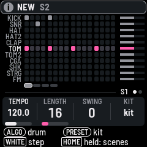

Eleven rows, one per drum, sixteen steps at a time. The picked drum is brighter; its level is the bar at the right.

| Control | Does |
|---|---|
| Knob 1 | Tempo (HOME held: fine) |
| Knob 2 | Length of the pattern, for every drum |
| Knob 3 | Swing |
| Knob 4, PRESETS | The kit |
| ALGORITHM | The drum, silently |
| White keys | Steps of the picked drum |
| Black keys | Pick a drum; held, its lane (below) |

Turn SELECT for the Scenes page, then the Song. HOME pressed again goes straight to the Song.

## SEQ: Steps, Bar, Generate

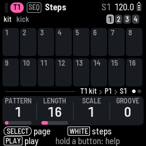

**Steps** shows the picked drum alone. Each step is a bar as tall as its velocity. Under a step:

- a short bar: its chance, as a share of the width. **A**: an A:B cycle. **F**: only in a fill. **N**: not in a fill.
- small ticks: its ratchets. A dot: another trick.
- a red dot at the top: the step holds locks.

The other ten drums run as thin lines beneath, so you can see where they fall.

ALGORITHM goes through the eleven drums and then on: the sample track, the slice track, the throws, the FX sequence,
and round to the first drum again. So every sequence is one turn of ALGORITHM away without leaving SEQ.

The four knobs are the picked drum's own, the same four as EDIT's first page. For nearly every model that is pitch,
length and its two main tone controls (`MACROS.md` lists all 73). PRESETS changes the pattern.

**Bar**: knob 1 quantise, knob 2 note length, knob 3 the steps' scale, knob 4 the lock shape.

**Generate**: as before. The grid previews what it would write; SEL writes it.

### Clearing

| Where | Row in SEL's list | Clears |
|---|---|---|
| SEQ | CLEAR (notes, locks, or both) | The picked drum's lane only: its hits, or the locks of its knobs. The other drums stay |
| HOME | CLEAR NOTES AND LOCKS | The kit's whole pattern |
| HOME | CLEAR SCENE | The scene and its notes: each track's pattern in the scene is emptied |

HOME + REC undoes the first two. A cleared scene's notes do not come back, so it asks first. A pattern that
another scene also plays is left alone, since it is that scene's too.

### A step held

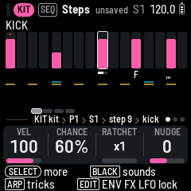

| Knob | Does |
|---|---|
| 1 | Velocity |
| 2 | Chance: always, 1 to 99%, then the A:B cycles, then fill and no fill |
| 3 | Ratchets, 1 to 9 hits in the step, then random |
| 4 | Nudge, earlier or later: the picked drum's own, where the step has other drums too |

Turn SELECT while holding for the step's other knobs: length on knob 2 and pitch in semitones on knob 4. Turn it
again to come back.

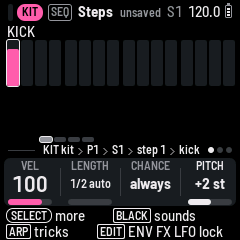

The nudge is in 24ths of a step, twelve either way. Knob 4 moves only the picked drum when other drums share the
step, so a snare can drag while the kick under it stays put; OCT− and OCT+ move the whole step. On Steps a nudged
hit's bar sits a little left or right of its place.

Press ARP while holding for the full list of tricks. Press EDIT, ENV, FX or LFO while holding to lock that page's
knobs on the step. Hold several steps and they change together. HOME + REC undoes.

A ratchet is a multiply trick that knob 3 puts on and takes off for you. If both of the step's tricks are already
something else, the screen says so and nothing changes.

### A drum held

Hold a black key on HOME or Steps:

| Knob | Does |
|---|---|
| 1 | Hits: that many, spread evenly |
| 2 | Rotate |
| 3 | Mutate |
| 4 | The drum's own length |

## EDIT, ENV, FX, LFO: the sound

These pages are the picked drum's, as before. What is new: the white keys are its steps here too. Tap one to write
it. Hold one and turn a knob to lock that knob for that step.

On the two effect pages, Mix and ARP's pages, where a step has nothing to lock, a held step's knobs are its velocity,
chance, ratchets and nudge.

**EDIT held:** turn a knob of the drum and it turns that knob on all eleven drums, each within its own range.
HOME + REC takes it back.

**RANDOM SOUND** in the drum's list (SEL on EDIT) puts another sound of its type on it.

### The sound browser

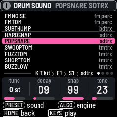

Turn PRESETS on a drum's EDIT page and a list of the 143 sounds opens, in the order of their engines, each with its
engine at the right. It opens on the drum's own engine.

| Control | Does |
|---|---|
| PRESETS | The next or the last sound: put on the drum and heard at once |
| ALGORITHM | The first sound of the next engine, or of the one before |
| HOME, SEL | Close the list. The sound stays on the drum |
| Keys, knobs | As on the page: play the drum, shape the sound |

HOME + REC takes a sound back.

## GLO held: mutes and fill

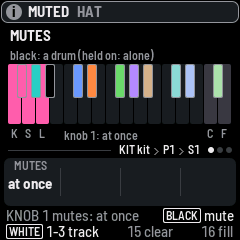

From any page, without leaving it:

| Key | Does |
|---|---|
| Black keys | Mute or unmute a drum. Held on: that drum alone, until you let go |
| White 1, 2, 3 | Mute the kit, the sample track, the slice track |
| White 15 | Clear every mute |
| White 16 | A fill while held: steps whose chance is "fill" play, "no fill" rest |
| Knob 1 | Mutes land at once, or at the next bar line |

A mute waiting for the bar blinks on its key. Stopping applies it.

## Scenes: HOME's second page

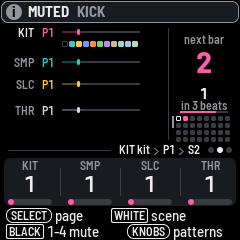

Turn SELECT on HOME: the pattern, then **Scenes**, then the Song. It is LOOM-8's Arrange page, drawn for WARP-8.

- **A row for each sequence**: KIT, SMP, SLC, THR (the throws) and FX (the FX sequence). Each shows which pattern it plays in this scene and a
  line with its playhead. A muted track is dim.
- **Under the kit, its eleven drums** as squares in their colours. A drum the scene mutes is hollow.
- **The scene playing**, large, at the right. When another is cued, its number and the beats until it starts.
- **The 32 scenes** as dots: the used ones lit, the mark at the left shows which sixteen the white keys hold.

| Control | Does |
|---|---|
| White keys | A scene, at the next bar. Again while it waits: now. An empty key: a copy of the scene playing. Held: asks to clear it |
| Black keys 1 to 5 | Mute or unmute a row's track: the kit, the sample track, the slice track, the throws, the FX sequence |
| Knobs 1 to 4 | A row's pattern in this scene: the kit's, the sample track's, the slice track's, the throws'. While it plays, the new pattern comes in at the bar |
| OCT−, OCT+ | Scenes 1 to 16, or 17 to 32 |
| PRESETS | The next scene |
| HOME held + knobs | Fine tempo, the groove type, the selected track's groove amount; knob 4 the selected row's pattern (the FX row's this way) |

So a scene is built here: set each track's pattern with its knob, mute tracks with the black keys, and mute single
drums with GLO held. Mutes follow GLO's setting: at once, or at the bar. This is the one page of the kit where the
white keys are not steps.

HOME held is LOOM-8's shift, as before: REC undoes, PLAY redoes, ALGORITHM picks the track, knob 1 is fine tempo.

## The FX sequence

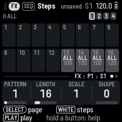

A fifth sequence, beside the kit, the sample track, the slice track and the throws. Its steps hold **amounts**, not
notes: how much of an effect, and when. Reach it with ALGORITHM on SEQ (after the throws), or HOME held + ALGORITHM.

It has eleven lanes. A black key picks one, as it picks a drum on the kit:

| Black key | Lane | A step's amount sets |
|---|---|---|
| 1 | I ALL | How much of every track goes into FX I on that step |
| 2 to 5 | I, its four knobs | FX I's own knobs: a delay's time, repeats, tone and so on |
| 6 | II ALL | How much of every track goes into FX II |
| 7 to 10 | II, its four knobs | FX II's own knobs |
| 11 | I > II | FX I's send into FX II |

| Control | Does |
|---|---|
| White key | A step of the picked lane. A tap gives it the lane's last amount, or takes it off |
| A step held + a later white key | The held step's amount on every step up to that one, as a throw is made longer |
| A step held + knob 1 | Its amount. Several held change together |
| Knob 1, PRESETS | The pattern |
| Knob 2, 3 | The pattern's length, and its steps' scale |
| Knob 4 | SHAPE: at 0 an amount lasts its step; turned up, amounts hold and ramp to the next one |

It looks and plays as the throws' sequence does: sixteen squares, the bars at the top right, a square lit where the
picked lane has an amount, with the lane's short name (ALL, K1 to K4, I>II) over the amount.

A step with an amount has it for that step; the next step without one gives the parameter back to where its own knob
is (the effect's page, or ALL on its Mix strip). So a reverb on the last beat of every bar is the lane II ALL with
steps 13 to 16 on: hold 13 and press 16. With SHAPE up, two steps far apart make a swell from one to the other.

On Scenes the FX sequence is the fifth row, with its own pattern in each scene, and the fifth black key mutes it:
muted, no amount is applied. EDIT, ENV, LFO and ARP have nothing for it and go back to the instrument.

It differs from the throws in that a throw is on or off and this has an amount, and in that it only reaches the two
effects: FX I and FX II, whatever they are set to.

## Mix: an effect on every track

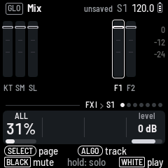

On Mix (GLO), turn ALGORITHM to the FX I or FX II strip. Knob 1 is **ALL**: how much of every track goes into that
effect, on top of what each drum or track already sends. Knob 4 is the effect's level.

With ALL up, whatever FX I or FX II is set to (chorus, delay, lofi, phaser, or a reverb on FX II) is heard on the
whole mix. It is a send: the effect is added to the dry sound, which stays.

## FX held: throws

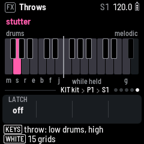

From any page of the kit, hold FX and the keys are the throws, as on the Throws page. Let go of FX and you are back
on your page with nothing left on, unless LATCH is on. A tap of FX still opens its pages.

The first octave is LOOM-8's twelve:

| White keys | | Black keys | |
|---|---|---|---|
| mute | nothing sounds | warble | a high-pass and a wobble |
| stutter | the last two sixteenths repeat | pan | the pan swings |
| repeat | the last beat repeats | octave | an octave up |
| echo | the stutter, fading | chop | every hit short |
| build | snares, eighths then sixteenths | ring | every hit long |
| floor | a kick on the beats, hats between | | |
| jumble | the first three drums at random | | |

The second octave is twelve more, in place of LOOM-8's melodic throws:

| White keys | | Black keys | |
|---|---|---|---|
| thin | only the hits on the eighths | low-pass | the kit's filter closes |
| roll | the step playing repeats, in sixteenths | delay | every hit all the way to FX I |
| buzz | the same in thirty-seconds | reverb | every hit all the way to FX II |
| soft | every hit quiet | hard | every hit at full |
| rise | each step a semitone higher, to two octaves | crush | the kit through a bit crusher |
| drop | each step a semitone lower | | |
| down | an octave down | | |

Both octaves now reach every track. Hortator's reverse, tape stop and freeze are not here: each needs a recording of
the output to play back, and there is neither the memory nor the flash for one. Drop is the nearest thing to a tape
stop that drum synthesis can do.

### GRIDS

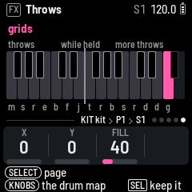

The fifteenth white key on the Throws page (so: FX held + that key) is GRIDS. While it is held, the kit's first three
drums play from the drum map and not from their steps. The other drums keep their steps.

| Control | Does |
|---|---|
| Knob 1, 2 | X and Y: where on the map |
| Knob 3 | FILL: how busy |
| SEL | Keep it: what is playing is written into the pattern |

With LATCH on, a press turns it on and the next turns it off. X, Y and FILL are the same ones Generate's GRIDS uses.

## What changed from 0.5

| 0.5 | Now |
|---|---|
| HOME held + keys: mutes and fill | GLO held + keys |
| HOME: white keys are scenes | HOME: white keys are steps; scenes are HOME's second page |
| HOME: a black key mutes a drum | It picks the drum |
| Steps: a grid of eleven lanes | The picked drum's lane; the grid is HOME's |
| Steps: knobs are pattern, length, scale, groove | The drum's four knobs. Pattern: PRESETS. Length, swing: HOME. Scale: Bar |
| Held step: velocity, length, chance, pitch | Velocity, chance, ratchets, nudge; SELECT for length and pitch |
| Mix with the kit selected: black keys mute and solo tracks | They pick drums. From another track they are the tracks, as before |
| Throws: on their page | Also FX held, from anywhere |
| The second octave: the melodic tracks' throws | Twelve more throws |
| EDIT: PRESETS steps through the sounds of the drum's type | A list of all the sounds by engine; ALGORITHM jumps engines |
| A nudge moves the whole step | Knob 4 moves the picked drum alone; OCT the whole step |
| CLEAR on SEQ empties the pattern; CLEAR SCENE keeps the notes | CLEAR on SEQ is the picked drum's lane; CLEAR SCENE takes its notes |
| A black key is silent while the pattern plays | It is heard |
| One colour for the kit | A colour for each drum |

## Not built

- Chaos, accents and the map's thirty-second notes in GRIDS; GRIDS recorded on the THROW track; the hollow cells
  that would show the map over the written pattern.
- Reverse, tape stop and freeze as throws (see above).
- Rolls of one drum, knobs that spring back in the FX layer, kit morph, more than one level of undo, kits as text.
